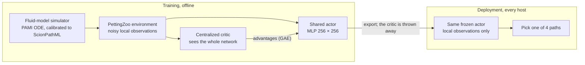

<div align="center">

# SCION MARL Path Selection

**Many hosts, one shared network, no talking at runtime.**<br>
Multi-agent reinforcement learning that trains one small, frozen path-selection policy for every SCION end host, so the population spreads its traffic instead of stampeding onto the same links.


[](https://github.com/HarshaVardhan3002/SCIONfit)

[Why](#why-this-exists) · [How it works](#how-it-works) · [Architecture](#architecture) · [Design decisions](#key-design-decisions) · [Setup](#setup) · [Status](#status)

</div>

A proof of concept for my Master's research on SCION path selection. Written in Python 3.11: about 5,500 lines of production code, a 27-run hyperparameter sweep, Pareto-optimal policy selection, and a distillation-ready export pipeline.

<table>
<tr>
<td align="center" width="20%"><h3>31</h3><sub>numbers each host observes, all local and noisy</sub></td>
<td align="center" width="20%"><h3>4</h3><sub>top-K path slots to choose from</sub></td>
<td align="center" width="20%"><h3>50 × 64</h3><sub>agents × shared links in the stress regime</sub></td>
<td align="center" width="20%"><h3>1,744</h3><sub>inputs to the training-only critic</sub></td>
<td align="center" width="20%"><h3>27</h3><sub>training runs: 9 reward mixes × 3 seeds</sub></td>
</tr>
</table>

> [!TIP]
> **Companion project:** [SCIONfit / scionarena](https://github.com/HarshaVardhan3002/SCIONfit) tests whether a path-selection model like this one survives being deployed alongside copies of itself.

## Why This Exists

SCION gives end hosts the authority to pick their own network paths. That is the whole point of the architecture. But when thousands of hosts independently pick what looks like the best path based on local RTT and bandwidth readings, they all pile onto the same links, cause congestion, then scatter, then pile on again. This is the classic traffic oscillation problem, and it gets worse at scale.

Previous work (Kruger et al. 2023) solved this with a centralized Path Oracle that aggregates telemetry and pushes routing recommendations. That works, but it reintroduces a single point of failure and a trust dependency that SCION was designed to eliminate.

This project takes a different approach. Instead of coordinating at runtime, we train agents offline with a centralized critic that sees the full network state, then throw the critic away and deploy only the per-agent actor. Each host runs the same small MLP, sees only its own local observations, and yet the population converges to a traffic distribution that avoids congestion without anyone talking to anyone else. The technical term is Centralized Training with Decentralized Execution (CTDE), implemented here via Multi-Agent Proximal Policy Optimization (MAPPO).

<p align="center">
  
  <br><sub>The oscillation this project is built to avoid, measured in <a href="https://github.com/HarshaVardhan3002/SCIONfit">SCIONfit</a>: a greedy "lowest RTT" model (red) throws its hosts back and forth; a model that spreads its advice (blue) holds steady.</sub>
</p>

## How it works



The critic sees everything during training and is then discarded. Each host keeps only the actor: the same small network, its own local view, and no messages to anyone.

## Architecture

Two Python packages, `scion_sim/` (the simulator and environment) and `scion_marl/` (the training stack), plus orchestration scripts, calibration and tests.

<details>
<summary><b>Open the module-by-module tour</b></summary>

The codebase is split into two top-level Python packages and a supporting infrastructure layer.

### `scion_sim/` -- Simulator and Environment

This is the physics engine. Instead of running a full packet-level network simulator (which would make RL training take weeks), the project builds a fluid-model simulator on top of the PAMI primal ODE equations (Addanki et al.). The inner loop works like this:

**Fluid Model (`wrapper/network.py`)** -- Implements multi-source AIMD flow dynamics. Each agent has one active path. Per-link loads are computed from all agents' flow rates, then a congestion penalty `(load/capacity)^beta` drives an Euler-step ODE update. The derivative follows PAMI Eq. 1: `dx/dt = (x/RTT) * [a_bar * (1 - lambda) - b * y * lambda]`, where `lambda` aggregates per-link penalty along the path. Flow rates are non-negative-clamped after each step.

**Control Plane (`control_plane/topology.py`)** -- Manages path birth, death, and visibility. Paths arrive via a Poisson process, live for a lognormal-distributed lifetime (calibrated to ScionPathML empirical medians of ~27,000 seconds), and die deterministically when their clock expires. Each path gets an 8-byte hex fingerprint matching the ScionPathML format. An asymmetric-view model means 30% of paths are only visible from one direction, simulating real SCION beacon propagation asymmetry.

**Observation Noise (`control_plane/observations.py`)** -- Agents do not see true path metrics. RTT is perturbed with log-normal noise (modeling queuing spikes), bandwidth is haircut by link utilization, loss scales with a utilization knee at 0.6, and jitter is derived from RTT with its own log-normal perturbation.

**PettingZoo Environment (`env/scion_marl_env.py`)** -- Wraps the simulator into a PettingZoo Parallel API environment. Each agent emits a 31-dimensional float32 observation vector in [-1, 1] and picks one of 4 top-K path slots via `Discrete(4)`. The observation layout is:
- 24 dims: 4 slots x 6 per-path features (mask bit, normalized RTT, normalized BW, loss, age, jitter)
- 7 scalar dims: visible path count, selected slot index, steps since last switch, RTT trend slope, BW trend slope, recent loss event fraction, churn indicator

**Observation Builder (`env/observation_builder.py`)** -- Maintains rolling per-agent state (deques for min-max normalization windows, trend regression, loss/churn history) and produces the 31-dim vector from raw simulator output each tick. Top-K ordering ranks paths by lowest RTT, ties broken by highest bandwidth.

**Reward Function (`env/reward.py`)** -- Three-term composite reward, each logged separately for ablation:
- `throughput_term`: bandwidth on selected path, normalized to mean link capacity
- `congestion_contribution`: per-agent share of over-utilization above a 0.7 threshold, summed across the selected path's links
- `diversity_term`: system-wide ratio of unique selected paths to total agents (pushes against everyone-on-one-path equilibria)

Weights are swept in Phase 2 across 9 configurations.

**Baselines (`baselines/`)** -- Three reference policies for benchmarking:
- `random_policy.py`: uniform random slot selection
- `shortest_path_policy.py`: always pick the lowest-RTT slot
- `oracle_greedy_policy.py`: EMA tracker over per-slot (bandwidth minus loss penalty), greedy argmax. Designed to approximate what a centralized oracle could recommend using only local observations.

### `scion_marl/` -- Training Stack

**Actor Network (`agent.py`)** -- Shared MLP with orthogonal initialization. Two hidden layers (256, 256) with tanh activation. The policy head uses gain=0.01 so initial actions are near-uniform. Action masking is applied as a large-negative additive bias before softmax, not as post-hoc probability zeroing. One network shared across all agents (parameter sharing is a deployment requirement, not just a training convenience: every host gets the same compiled artifact).

**Centralized Critic (`critic.py`)** -- Takes the full global state as input: all agents' 31-dim observations stacked, one-hot encodings of each agent's selected slot, and per-link utilization values. With the stress-regime defaults (50 agents, 31-dim obs, top-K=4, 64 links), the critic input is 1,744 dimensions. Outputs a single scalar V(s) shared across all agents. This network is discarded after training.

**Rollout Buffer (`buffer.py`)** -- Pre-allocated on-policy buffer indexed as (T timesteps, N agents). Stores observations, actions, masks, log-probs, rewards, dones, global states, and critic values. GAE-lambda advantage computation runs backward through the buffer after each rollout. Minibatch iteration flattens (T, N) to (T*N) and yields random permutations with z-score advantage normalization.

**MAPPO Trainer (`mappo.py`)** -- CleanRL-style single-file trainer. Standard PPO clipped objective with unclipped value loss. Logs to both TensorBoard and a JSONL file per run. Has an auto-restart mechanism: if policy entropy collapses below 0.05 before episode 200, the actor and critic are re-initialized once with a bumped entropy coefficient (0.05). This fires at most once per run. Checkpoints are saved every 200 episodes with full state (actor, critic, config, episode count, entropy coefficient).

**Device Selection (`device.py`)** -- Tries CUDA/ROCm with a smoke test (init + matmul + autograd verification), falls back to CPU on any failure. The diagnostic record (backend, reason, torch version, platform) is written into every run manifest for reproducibility.

**Configuration (`config.py`)** -- Pydantic models throughout. `Phase2Config` wraps `Phase1Config` (which wraps `SimulatorConfig`) with MAPPO hyperparameters. The 9-cell sweep varies reward weights while holding MAPPO hyperparameters constant. Each sweep cell generates a separate YAML config.

### `scripts/` -- Orchestration

- `run_phase2_sweep.py`: Reads 9 YAML configs, expands across 3 seeds (42, 1337, 2024), runs 27 total training jobs with configurable parallelism via Python multiprocessing. Each worker lazily imports torch to avoid Windows spawn issues.
- `run_phase2_evaluation.py`: Loads trained checkpoints and runs 100 fresh evaluation rollouts per policy, computing aggregate throughput, Jain fairness, link utilization variance, and median RTT.
- `run_phase2_select_and_report.py`: Aggregates evaluation results, computes the Pareto frontier across (throughput, latency, oscillation), picks the most balanced Pareto-optimal config using normalized Euclidean distance to the ideal corner, exports the winning checkpoint, and generates a full report with comparison scatter plots.
- `run_baselines.py` / `run_baselines_stress.py`: Run the three baseline policies through the environment and write sharded Parquet trajectories with per-episode metrics (Jain fairness, oscillation, median RTT).
- `run_smoke.py`: Quick sanity check that the environment, observation builder, and reward function work end-to-end.
- `refresh_external.sh`: Re-clones vendored upstream repos (PAMI, ScionPathML).

### `calibration/`

- `extract_scionpathml_summary.py`: Parses the public ScionPathML dataset and produces `data/scionpathml_summary.json` (6.7 MB of empirical path lifetime distributions, RTT medians, and bandwidth profiles).
- `calibrate.py`: Tunes simulator parameters to match the empirical summary statistics.

### `data/`

- `scionpathml_summary.json`: Committed empirical summary (6.7 MB). The ground truth that the simulator is calibrated against.
- Generated trajectories (gitignored).

### `configs/phase2/`

Nine YAML sweep configurations:
`sweep_01_balanced`, `sweep_02_throughput_heavy`, `sweep_03_throughput_light`, `sweep_04_congestion_heavy`, `sweep_05_congestion_light`, `sweep_06_diversity_heavy`, `sweep_07_diversity_light`, `sweep_08_high_pressure`, `sweep_09_loose`

Each defines a stress-regime topology (50 agents, 12 paths each, 64 shared links, 35 Mbps mean capacity) with different reward weight combinations.

### `tests/`

Four test modules covering the core pipeline:
- `test_simulator.py`: Fluid model integration, path birth/death, flow rate convergence
- `test_observation_builder.py`: 31-dim vector construction, normalization windows, top-K ordering
- `test_reward.py`: All three reward terms, edge cases (no selection, single agent, full congestion)
- `test_env_smoke.py`: Full PettingZoo API compliance, reset/step cycle, action masking

</details>

## Key Design Decisions

**Parameter sharing across agents.** Not an ML shortcut. This is a hard deployment constraint. The trained model ships as a single frozen artifact to every host. N-policy training (one policy per agent) would require knowing which host you are at deployment time, which breaks the SCION host-authority model.

**Fluid model over packet simulation.** A packet-level simulator would take orders of magnitude longer per episode. The fluid ODE captures congestion dynamics at the timescale that matters for path selection (seconds, not milliseconds) while running fast enough to train 1,500 episodes per sweep cell.

**Observation noise by design.** Agents never see ground-truth metrics. RTT, bandwidth, loss, and jitter are all perturbed with distribution-specific noise models calibrated to real measurement artifacts. This prevents the policy from overfitting to clean simulator state.

**Three-term reward with sweep.** Rather than hand-tuning reward weights, the system trains 9 reward configurations across 3 seeds and selects the Pareto-optimal one automatically. The sweep output is a reproducible report with scatter plots and a recommended winner.

**Auto-restart on entropy collapse.** Early training can cause the policy to degenerate to a single deterministic action. The trainer detects this (entropy below 0.05 before episode 200) and re-initializes once with a higher entropy coefficient. This is logged in the run manifest and happens at most once.

## Setup

Requires Python 3.11 and [uv](https://github.com/astral-sh/uv).

```bash
uv sync
uv run pytest
```

### Running the full pipeline

```bash
# Phase 2: train all 27 sweep cells (9 configs x 3 seeds)
uv run python scripts/run_phase2_sweep.py

# Evaluate trained policies (100 episodes each)
uv run python scripts/run_phase2_evaluation.py

# Select winner and generate report
uv run python scripts/run_phase2_select_and_report.py
```

### Quick smoke test

```bash
uv run python scripts/run_smoke.py
```

## Status

The simulator, environment, MAPPO trainer, sweep, evaluation and Pareto-selection pipeline are built and tested (`tests/`). Trained checkpoints and sweep reports are generated locally and are not committed, so this repository shows the system, not a results table.

## Tech Stack

| Layer | Tools |
|---|---|
| Language | Python 3.11 |
| RL framework | PettingZoo (Parallel API), Gymnasium |
| Training | PyTorch, MAPPO (custom implementation) |
| Data | Parquet (PyArrow), ZSTD compression |
| Configuration | Pydantic v2, YAML |
| Visualization | Matplotlib, Seaborn, TensorBoard |
| Testing | pytest, pytest-cov |
| Linting | Ruff |
| Package management | uv, hatchling |
